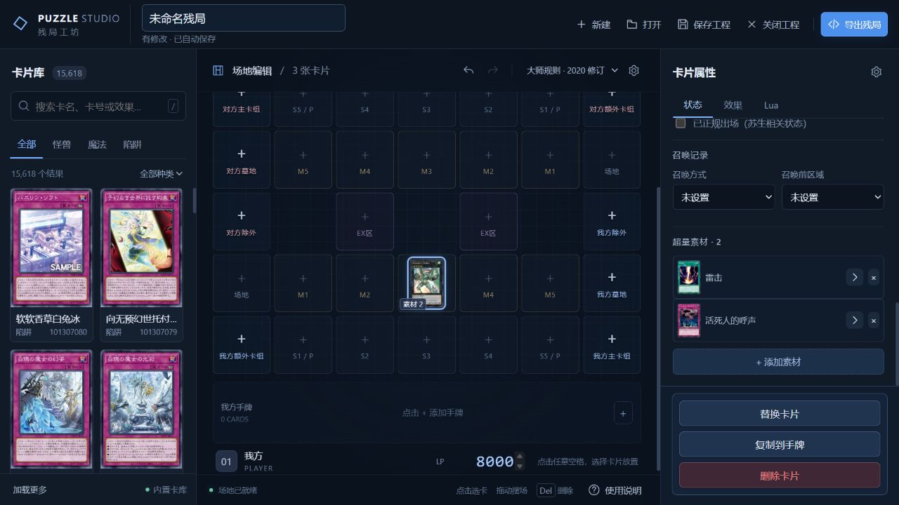

# Puzzle Studio · 游戏王残局编辑器

用于制作和编辑 YGOPro / MDPro3 Lua 残局的本地工具。支持直接点击场地放置卡片、调整状态和效果、保存工程及导出 Lua。

## 下载

[下载 Windows x64 便携包 0.2.1](https://github.com/Hongxi-ovo/PuzzleStudio/releases/download/v0.2.1/PuzzleStudio-0.2.1-Windows-x64.zip) · [全部版本](https://github.com/Hongxi-ovo/PuzzleStudio/releases)

解压后运行 `PuzzleStudio.exe`。程序已内置卡库、Lua 脚本、默认完整卡图及卡背，无需安装 Python、Node.js 或另外提供游戏资源。运行环境为 Windows 10/11 x64、WebView2 Runtime 和 .NET Framework 4.8。

## 功能

- 支持双方场地、共享 EX 区、灵摆区、手牌、主卡组、额外卡组、墓地和除外区。
- 支持大师规则 3、2017 新大师规则及 2020 修订规则。
- 卡片可拖动摆放、修改表示形式、数值、属性、种族、抗性、指示物及对象关系。
- 超量素材支持怪兽、魔法和陷阱混合添加；替换素材保留宿主关系。
- 可从卡片脚本提取支持的素材赋予效果，也可为游戏内已有卡片编写残局内 Lua 片段。
- 支持 JSON 工程、Lua 导入导出、开场提示和逐行残局说明；不能图形化解释的 Lua 保留原文。
- 完整卡面显示、守备与翻面动画；高清卡图按需下载并缓存在本地。



## 从源码运行

需要 Python 3.10+。前端无需构建，浏览器版不依赖第三方 Python 包。

```powershell
git clone https://github.com/Hongxi-ovo/PuzzleStudio.git
cd PuzzleStudio
./Get-Resources.ps1
python Tools/PuzzleEditor/server.py --open
```

默认打开 <http://127.0.0.1:18743/>。也可双击 `Tools/PuzzleEditor/Start.cmd`。通过 `--root "目录"` 选择残局读写目录，通过 `--port` 修改端口。

默认卡图约 312 MiB，单独存放在 Release；`Get-Resources.ps1` 下载后按资源清单校验 SHA-256。也可手动下载 [pics.zip](https://github.com/Hongxi-ovo/PuzzleStudio/releases/download/v0.2.1/pics.zip)，放到 `Tools/PuzzleEditor/resources/pics.zip`。Windows 便携包已包含这份资源，无需额外下载。

## 构建 Windows 程序

```powershell
./Get-Resources.ps1
./Tools/PuzzleEditor/Build-Windows.ps1
```

构建脚本创建独立 Python 环境，并输出单文件 EXE 和包含依赖许可说明的便携 ZIP 到 `Dist/`。

## 检查

```powershell
python -m unittest discover -s Tools/PuzzleEditor/tests -p "test_*.py"
node Tools/PuzzleEditor/tests/card_display.mjs
```

原生核心兼容性检查需要已有的 MDPro3 工作区与 Node.js：

```powershell
$env:MDPRO3_ROOT = "你的 MDPro3 工作区路径"
python Tools/PuzzleEditor/tests/native_compat.py
python Tools/PuzzleEditor/tests/native_features.py
```

0.2.1 已在开发工作区通过 144 项原生功能检查、18 项 Python 检查和 4 项 Windows 成品检查，包含双方混合超量素材的保存重开与 Lua 往返验证。

详细操作见 [使用说明](Tools/PuzzleEditor/README.md)，已验证范围和限制见 [兼容性记录](Tools/PuzzleEditor/COMPATIBILITY.md)，资源来源见 [第三方内容说明](THIRD_PARTY.md)。
